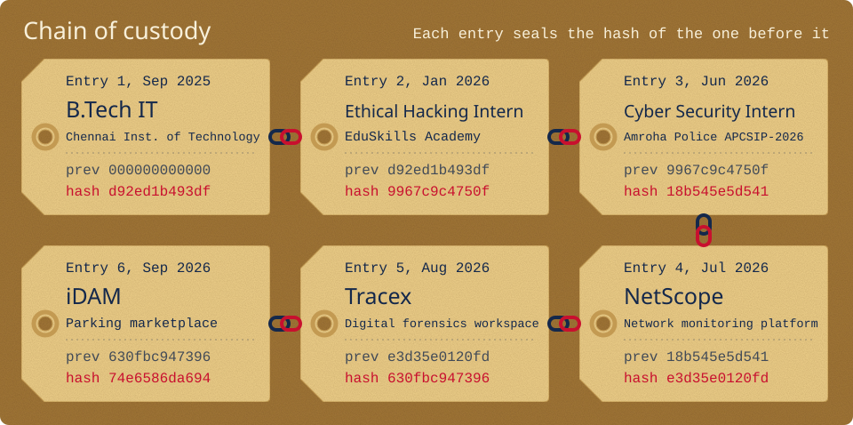
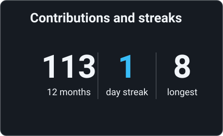
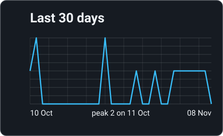
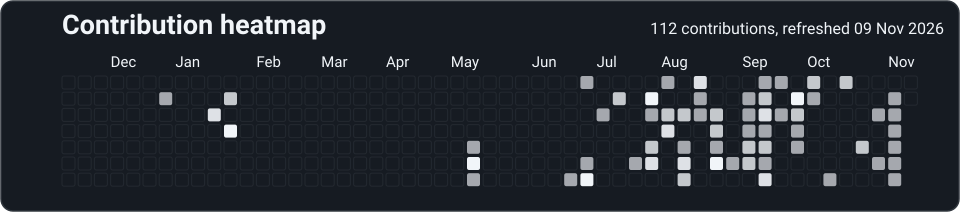

B.Tech Information Technology student building full-stack web and Android applications, network monitoring tools and security software. I work with Java, Spring Boot, React, TypeScript, Python, PostgreSQL and Docker, and I have completed two cybersecurity internships. I'm looking for software development, networking or cybersecurity internships.

## Career, as a hash chain

Tracex keeps its audit log tamper-evident by hashing each record together with the one before it, so I did the same with this resume. Change one word in any entry and every later hash stops matching. Run `python3 scripts/verify_chain.py` to check it yourself.

## GitHub stats

<table>
<tr>
<td width="50%"></td>
<td width="50%"></td>
</tr>
<tr>
<td width="50%"></td>
<td width="50%"></td>
</tr>
</table>

## Experience

### Ethical Hacking Intern

EduSkills Academy (AICTE Virtual Internship), remote  
Jan 2026 – Mar 2026  
Chain entry 2, hash <code>9967c9c4750f</code>

- Performed basic vulnerability assessment and web application penetration testing using Kali Linux and security testing tools.
- Studied social engineering, malware analysis, network security and common web application vulnerabilities.
- Completed a 10-week program and a cybersecurity capstone project.

### Cyber Security Intern

Amroha Police Cyber Security Internship Program (APCSIP-2026), Moradabad  
Jun 2026  
Chain entry 3, hash <code>18b545e5d541</code>

- Studied OSINT, digital and mobile forensics, Android malware, threat intelligence, MITRE ATT&CK and cyber law in sessions led by law-enforcement and industry experts.
- Gained exposure to forensic tools including FTK, Oxygen Forensics, Magnet Axiom and Belkasoft.
- Examined cybercrime cases involving UPI fraud, mule accounts and SIM-swap attacks.

## Projects

### [iDAM: parking marketplace (web and Android)](https://github.com/KiShOrE-2008/iDAM)

React, TypeScript, Capacitor, Supabase, PostgreSQL, Razorpay  
Sep 2026 – Oct 2026  
Chain entry 6, hash <code>74e6586da694</code>

- Built a two-sided parking marketplace with map search, time-slot booking, online payments and QR passes, shipped as a website and an Android app from one React codebase.
- Secured bookings, payments and payouts with row-level security and server-side functions, giving clients no write access to those tables.
- Implemented owner payouts through Razorpay Route, held for 24 hours after each booking ends.

### [Tracex: digital forensics workspace (hackathon, team of 3)](https://github.com/KiShOrE-2008/Tracex)

React, TypeScript, Leaflet  
Aug 2026  
Chain entry 5, hash <code>630fbc947396</code>

- Built a prototype that links suspects, phone numbers, accounts and locations using entity graphs, geospatial mapping and timelines.
- Added SHA-256 evidence hashing and a hash-chained audit log to support chain of custody.

### [NetScope: network discovery and monitoring](https://github.com/KiShOrE-2008/Netscope)

Java 21, Spring Boot, PostgreSQL, React, WebSockets, Docker  
Jul 2026 – Sep 2026  
Chain entry 4, hash <code>e3d35e0120fd</code>

- Built a monitoring platform with ICMP and TCP subnet discovery, Nmap scanning, SNMP metrics, automated alerts and live WebSocket updates.
- Discovered 22 devices on a /24 test network, with 20 online and 12 reporting SNMP data.
- Containerized the application with Docker and tested REST APIs with JUnit and Mockito.

## Education

**Chennai Institute of Technology**  
B.Tech Information Technology, Sep 2025 – Aug 2029, CGPA 7.4/10  
Chain entry 1, hash <code>d92ed1b493df</code>

## Skills

| | |
|---|---|
| **Languages** | Python, Java, JavaScript, TypeScript, C, C++ |
| **Frontend** | HTML5, CSS3, React.js, Tailwind CSS, Vite, GSAP |
| **Backend** | Java Spring Boot, Node.js, Express.js, FastAPI, Flask, REST APIs, WebSockets |
| **Databases** | PostgreSQL, MongoDB, MySQL, Supabase |
| **Cybersecurity** | Application security, authentication and authorization, JWT, password hashing, CSRF protection, role-based access control, security auditing, Wireshark, Burp Suite |
| **Networking** | TCP/IP, network discovery, SNMP, Nmap, network monitoring, DNS diagnostics, network telemetry |
| **Mobile** | Android development with Capacitor, QR code integration, third-party API integration |
| **DevOps and tools** | Git, GitHub, Docker, Docker Compose, Linux, Maven, Vercel, VS Code |

## Certifications

- Python Essentials 1 and 2, Cisco Networking Academy (2025, 2026)
- Introduction to Cybersecurity, Cisco (Dec 2025)
- Cybersecurity Job Simulation, Forage and Mastercard (May 2026)
- Python (Basic), HackerRank (Feb 2026)
- Cybersecurity Career Starter, Hack & Fix (Jan 2026)

## Achievements

- Solved 255 LeetCode problems with a contest rating of 1551 across 27 contests.
- Ranked Top 20 in the CyberStrike’26 CTF and Top 60 in the Into The Void CTF.
