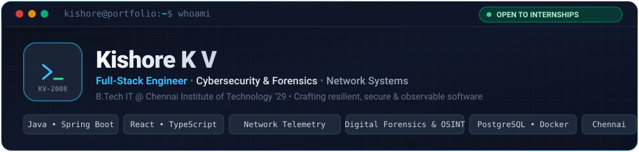
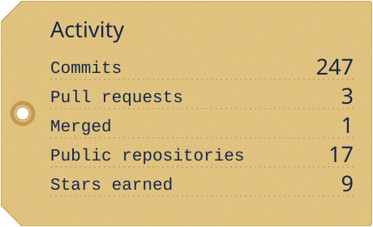
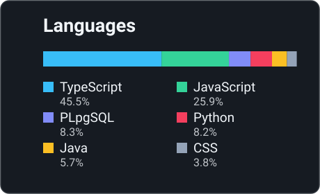

  

  
  
  
  
  

 

> **B.Tech Information Technology student at Chennai Institute of Technology ('29)**  
> Engineering secure full-stack applications, real-time network observability platforms, and digital forensics tooling. Bridging the gap between scalable software architecture and low-level security fundamentals.

---

### ⚡ What I Do

- **💻 Full-Stack Architecture** — Designing end-to-end web and mobile applications using **Java Spring Boot**, **React**, **TypeScript**, and **PostgreSQL**. Dedicated to clean API contracts, type safety, and strict row-level security.
- **🛡️ Cybersecurity & Forensics** — Practical experience in web vulnerability auditing (OWASP Top 10), OSINT, and digital/mobile forensics (FTK, Magnet Axiom) through law-enforcement and AICTE virtual internships.
- **📡 Networking & Observability** — Building automated subnet scanners, TCP/ICMP network sweeps, SNMP telemetry collectors, and low-latency WebSocket live streams.

---

### 🚀 Featured Projects

#### 🚗 [iDAM — Smart Parking Marketplace (Web & Android)](https://github.com/KiShOrE-2008/iDAM)
`React` • `TypeScript` • `Capacitor (Android)` • `Supabase` • `PostgreSQL` • `Razorpay Route`

- Built a two-sided parking reservation marketplace featuring real-time map discovery, time-slot scheduling, and dynamic QR passes.
- Shipped both a responsive web app and an Android APK from a single unified React codebase via Capacitor.
- Hardened transactions with PostgreSQL Row-Level Security (RLS) and serverless database functions to prevent direct client write access.
- Implemented an automated payout pipeline with Razorpay Route, enforcing a 24-hour post-booking escrow hold.

#### 📡 [NetScope — Subnet Discovery & Network Monitoring](https://github.com/KiShOrE-2008/Netscope)
`Java 21` • `Spring Boot 3` • `PostgreSQL` • `React` • `WebSockets` • `Docker`

- Engineered an enterprise network observer combining ICMP ping sweeps, TCP port probing, and integrated Nmap audit scans.
- Collects live SNMP telemetry and streams device uptime, latency, and status changes in real time via persistent WebSockets.
- Discovered and monitored 22 live nodes on a `/24` test subnet; fully containerized with Docker & Docker Compose.

#### 🔍 [Tracex — Digital Forensics & Link Analysis Workspace](https://github.com/KiShOrE-2008/Tracex)
`React` • `TypeScript` • `Leaflet` • `Graph Intelligence`

- Built a forensics analysis workspace during a hackathon that links suspects, virtual phone numbers, UPI accounts, and crime scenes.
- Visualizes complex relationships through interactive multi-hop entity graphs and geospatial crime timelines.
- Guaranteed evidence integrity by implementing SHA-256 evidence hashing and a tamper-evident audit trail for chain-of-custody verification.

---

### 💼 Experience

#### 🛡️ Cyber Security Intern — [Amroha Police Cyber Security Internship Program (APCSIP-2026)](https://github.com/KiShOrE-2008)
*Jun 2026 • Moradabad, India*
- Trained with law-enforcement specialists on OSINT, mobile forensics, threat intelligence, and the MITRE ATT&CK matrix.
- Analyzed real cybercrime cases involving UPI financial fraud, money mule accounts, and SIM-swap attack vectors.
- Hands-on investigation using enterprise forensics suites: **FTK**, **Oxygen Forensics**, **Magnet Axiom**, and **Belkasoft**.

#### 🔐 Ethical Hacking Intern — [EduSkills Academy (AICTE Virtual Internship)](https://github.com/KiShOrE-2008)
*Jan 2026 – Mar 2026 • Remote*
- Conducted vulnerability assessments and web application penetration tests using Kali Linux and security testing suites.
- Researched malware analysis, social engineering defense, network protocols, and OWASP Top 10 vulnerabilities.
- Completed a 10-week intensive curriculum culminating in a comprehensive cybersecurity capstone project.

---

### 🛠️ Technical Arsenal

| Category | Technologies & Tools |
| :--- | :--- |
| **Languages** | `Java` `Python` `TypeScript` `JavaScript` `C` `C++` `SQL` `Bash` |
| **Backend & Cloud** | `Spring Boot` `Node.js` `Express` `FastAPI` `PostgreSQL` `Supabase` `WebSockets` |
| **Frontend & Mobile** | `React` `Tailwind CSS` `Vite` `HTML5` `CSS3` `Capacitor (Android)` |
| **Security & Forensics** | `Kali Linux` `Burp Suite` `Wireshark` `Nmap` `FTK` `Magnet Axiom` `OSINT` |
| **DevOps & Tooling** | `Docker` `Docker Compose` `Git` `GitHub` `Linux` `Maven` `Postman` `Vercel` |

---

### 🏆 Competitions & Achievements

- 💡 **LeetCode**: Solved **255+ problems** with a **1551 contest rating** across 27 competitive contests.
- 🚩 **Capture The Flag (CTF)**: Ranked **Top 20** in *CyberStrike'26 CTF* and **Top 60** in *Into The Void CTF*.
- 🎓 **Education**: B.Tech in Information Technology at **Chennai Institute of Technology** (Sep 2025 – Aug 2029) • **CGPA 7.4 / 10**.
- 📜 **Certifications**: Cisco Networking Academy (*Python Essentials 1 & 2*, *Introduction to Cybersecurity*) • Mastercard/Forage (*Cybersecurity Job Simulation*).

---

### 📊 GitHub Activity

  
  

---

  Crafted with focus by Kishore K V • Open to full-stack, networking & security opportunities

